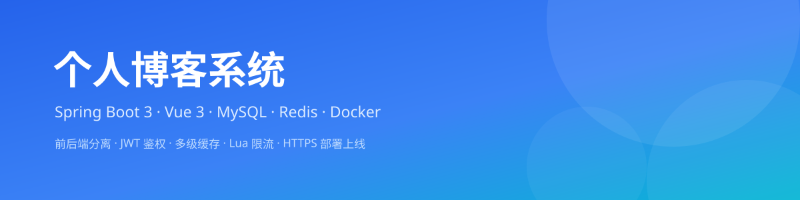
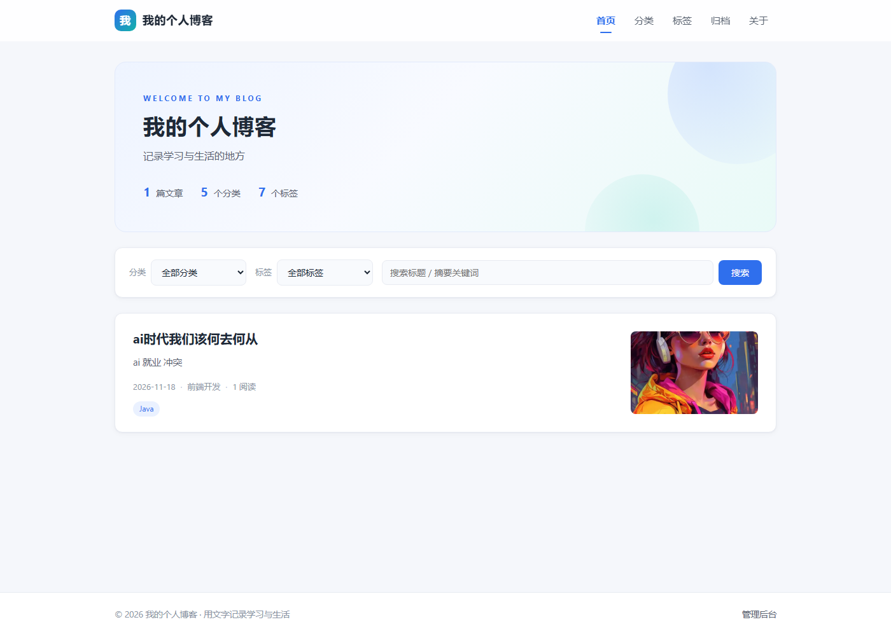
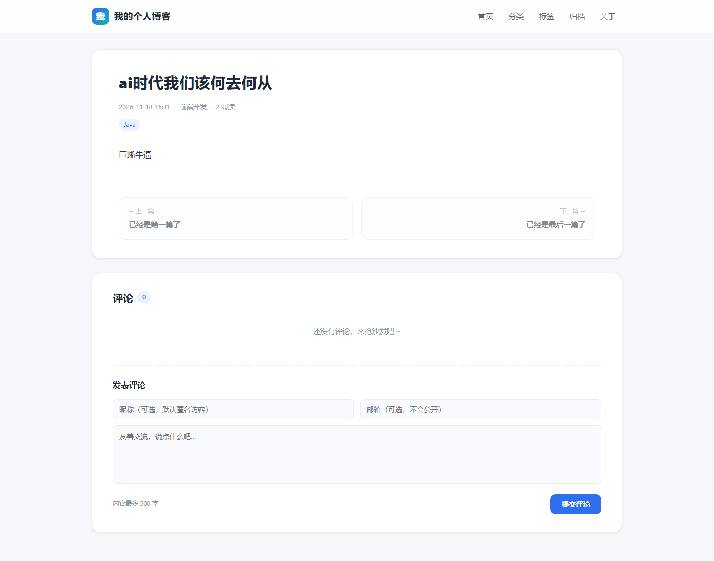
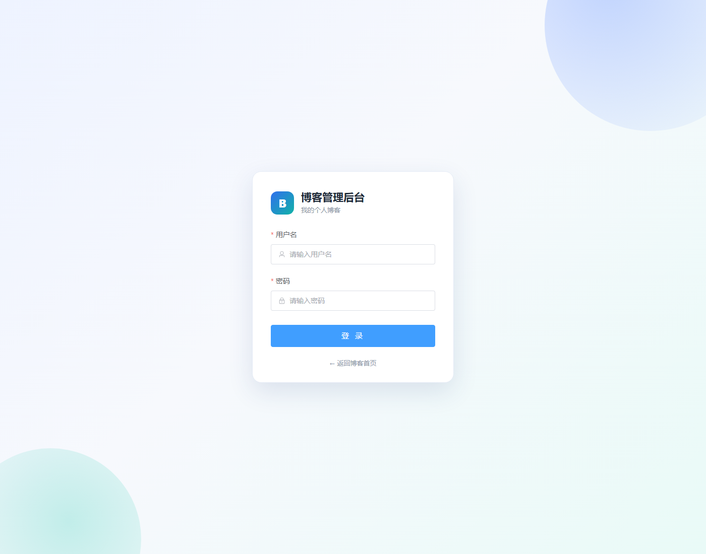

# 个人博客系统

> 一个**前后端分离**的个人博客系统，完整实现「需求分析 → 系统设计 → 编码 → 测试 → 部署上线」全流程，已部署上线并开启 HTTPS。

## 🌐 在线演示

| 端 | 地址 |
|----|------|
| 博客前台 | <https://wangcangsuanlafen.top> |
| 后台管理 | <https://wangcangsuanlafen.top/admin/login>（演示账号不公开） |

> 站点部署在阿里云 ECS（Ubuntu 22.04），Docker Compose 编排，Nginx 托管前端并反向代理，已配置 HTTPS。

## 📸 界面预览

**前台首页**

**文章详情**

**后台登录**

## ✨ 功能特性

### 博客前台
- 首页文章列表（分页、置顶、分类/标签筛选、关键词搜索）
- 文章详情（Markdown 渲染 + 代码高亮、浏览量、上一篇/下一篇）
- 分类、标签云、归档时间线、关于页
- 评论（二级回复）

### 后台管理
- JWT 登录、路由守卫
- 文章管理（Markdown 编辑 + 实时预览、草稿/发布、置顶、封面）
- 分类 / 标签 / 评论管理
- 站点设置、仪表盘统计

### 技术亮点
| 能力 | 实现 |
|------|------|
| 统一响应 / 全局异常 | Result + GlobalExceptionHandler，业务异常统一处理 |
| 认证鉴权 | Spring Security + JWT 过滤器链，后台接口 401 拦截 |
| **多级缓存** | Caffeine（本地）→ Redis（分布式）→ MySQL，写操作精准失效 |
| **接口限流** | Redis Lua 脚本原子限流（登录 5 次/分钟、评论 10 次/分钟） |
| **浏览量统计** | Redis INCR 计数 + 定时任务批量回写 MySQL，避免高频写库 |
| 一键部署 | Docker Compose（MySQL + Redis + 后端 + Nginx），HTTPS + 域名 |

## 🛠 技术栈

| 层 | 技术 |
|----|------|
| 后端 | Spring Boot 3.2.5 + MyBatis-Plus 3.5.7 + MySQL 8 + Redis 7 + Caffeine + Spring Security + JWT + Knife4j |
| 前端 | Vue 3 + Vite 5 + Vue Router 4 + Pinia + Axios + Element Plus + markdown-it + highlight.js |
| 部署 | Docker Compose + Nginx + HTTPS |

## 📁 项目结构

    ├─ blog-backend/    # Spring Boot 后端（单模块）
    │  └─ src/main/java/com/blog/
    │     ├─ config/    # 配置（MP 分页、Redis、Caffeine、Security、CORS、Knife4j、数据初始化）
    │     ├─ controller/# 接口层（公开接口 + admin 后台接口）
    │     ├─ service/   # 业务层（接口 + impl）
    │     ├─ mapper/    # MyBatis-Plus Mapper
    │     ├─ entity/    # 实体
    │     ├─ dto/ vo/   # 入参 / 出参
    │     ├─ cache/     # 多级缓存、Lua 限流、浏览量计数
    │     ├─ security/  # JWT 工具与过滤器
    │     └─ common/    # 统一返回、异常、工具
    ├─ blog-web/        # Vue3 + Vite 前端（前台 + 后台路由）
    │  └─ src/
    │     ├─ views/front/   # 前台 6 个页面
    │     ├─ views/admin/   # 后台 8 个页面
    │     ├─ router/ stores/ api/ utils/ layouts/ components/ assets/
    ├─ sql/             # schema.sql（建库建表）/ data.sql（初始化数据）
    ├─ nginx/           # Nginx 配置（HTTP + HTTPS 反向代理）
    ├─ mysql/           # MySQL 字符集配置（utf8mb4）
    ├─ scripts/         # 测试脚本（smoke-test.ps1 / functional-test.mjs）
    ├─ docs/            # 文档 + 界面截图 + banner
    ├─ docker-compose.yml
    └─ README.md

## 📚 项目文档

| 文档 | 说明 |
|------|------|
| [开发计划文档](docs/开发计划文档.md) | 瀑布模型五阶段、里程碑规划 |
| [API 接口文档](docs/API接口文档.md) | 前后端接口契约（路径/字段/错误码） |
| [测试用例与报告](docs/测试用例与报告.md) | 29 项自动化测试全部通过 |
| [部署上线文档](docs/部署上线文档.md) | 阿里云 ECS 从零到上线完整步骤 |

## 🚀 快速开始

### 1. 准备数据库

1. 启动本机 MySQL 8，依次执行：
   - sql/schema.sql（建库 + 7 张表）
   - sql/data.sql（初始化分类、标签、站点设置）
2. 创建 blog-backend/src/main/resources/application-local.yml，写入本机数据库与 Redis 配置：

       spring:
         datasource:
           url: jdbc:mysql://localhost:3306/blog?useUnicode=true&characterEncoding=utf8&serverTimezone=Asia/Shanghai&useSSL=false&allowPublicKeyRetrieval=true
           username: root
           password: "你的MySQL密码"
         data:
           redis:
             host: localhost
             port: 6379
             password: "你的Redis密码（没有可留空）"
             database: 0

   该文件已被 .gitignore 忽略，不会上传到 GitHub。

### 2. 启动后端

    cd blog-backend
    mvn spring-boot:run

- 服务地址：http://localhost:8080
- 接口文档：http://localhost:8080/doc.html
- 首次启动自动创建管理员：admin / 123456（上线后请立即修改）

### 3. 启动前端

    cd blog-web
    npm install          # 慢时加 --registry https://registry.npmmirror.com
    npm run dev

- 前台：http://localhost:5173/
- 后台：http://localhost:5173/admin/login

### 4. 运行测试

    # 接口冒烟测试（需后端已启动）
    powershell -ExecutionPolicy Bypass -File scripts/smoke-test.ps1

    # 功能测试（Node 原生 UTF-8，推荐）
    node scripts/functional-test.mjs

## 🚀 部署上线

- 详细步骤：[docs/部署上线文档.md](docs/部署上线文档.md)
- 配套文件：docker-compose.yml、blog-backend/Dockerfile、nginx/blog.conf、mysql/my.cnf、.env.example
- 架构：Nginx（80/443）→ 前端静态资源 + 反向代理 /api → Spring Boot（8080）→ MySQL / Redis，全部容器化

## 📝 Git 提交规范

提交信息格式：<type>: <描述>，type 取 feat / fix / docs / refactor / test / chore。

## 📄 许可证

MIT
